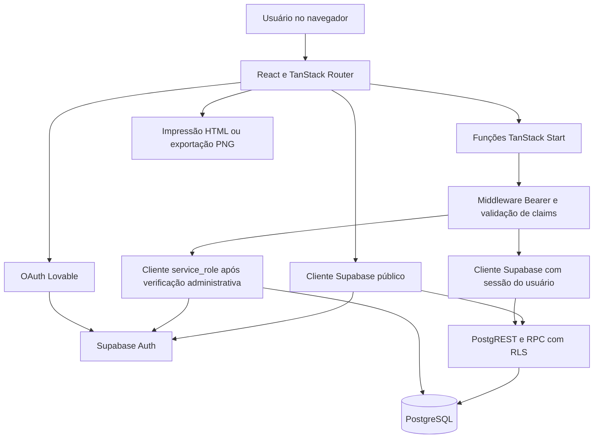

# Arquitetura e estrutura

## 1. Stack identificada

Versões abaixo são as faixas declaradas no `package.json`, não uma garantia da versão instalada em todos os ambientes.

| Camada | Tecnologia | Papel |
| --- | --- | --- |
| Interface | React `^19.2.0`, TypeScript `^5.8.3` | Telas, componentes e tipagem |
| Aplicação web | TanStack Start `^1.167.50` | SSR, funções de servidor e rotas HTTP |
| Navegação | TanStack Router `^1.168.25` | Rotas geradas a partir de arquivos |
| Build | Vite `^7.3.1` | Desenvolvimento e compilação |
| Configuração de build | `@lovable.dev/vite-tanstack-config` `2.23.1` | Agrega plugins, Nitro, configuração de ambiente e instrumentação |
| Runtime de build servidor | Nitro `3.0.260603-beta` | Empacotamento do servidor; preset padrão descrito como Cloudflare no Vite config |
| Dados e sessão | `@supabase/supabase-js` `^2.108.1` | Auth, PostgREST e RPC |
| Banco | PostgreSQL/Supabase | Persistência, constraints, triggers e RLS |
| Migrações adicionais | Drizzle Kit `^0.31.10` | Histórico SQL separado; schema TypeScript vazio |
| Estilos | Tailwind CSS `^4.2.1`, `tw-animate-css` | Utilitários, tokens CSS e animações |
| Componentes | shadcn/ui, Radix UI, Lucide | Biblioteca base, acessibilidade de primitives e ícones |
| Datas | date-fns `^4.1.0` | Cálculo e formatação de abertura/validade |
| Validação no servidor | Zod `^3.24.2` | Entradas de funções administrativas e de atividade |
| QR Code | qrcode `^1.5.4` | Data URLs e QR Code de etiquetas/estabelecimentos |
| OAuth | `@lovable.dev/cloud-auth-js` `^1.1.2` | Login Google intermediado pelo Lovable |

React Query tem provider e cliente globais, mas os fluxos principais usam `useState`, `useEffect` e chamadas diretas ao Supabase. Sua presença não implica cache de consultas, invalidação ou paginação implementados.

## 2. Fluxo de comunicação

O servidor é necessário para administração master. A aplicação não deve ser tratada como uma SPA que pode ser publicada apenas copiando HTML e JS para um host estático.

## 3. Mapa de diretórios

| Caminho | Responsabilidade |
| --- | --- |
| `src/routes/index.tsx` | Aplicação principal: login, sessão, navegação, dashboard, cadastros, impressão, PVPS e histórico; 1.310 linhas na análise |
| `src/routes/admin.tsx` | Painel master, empresas, usuários, carteira e atividades; 388 linhas |
| `src/routes/__root.tsx` | HTML raiz, providers, fontes, metadados, rodapé e tratamento visual de erro/404 |
| `src/routes/e.$code.tsx` | Entrada por QR Code do estabelecimento |
| `src/routes/label.$token.tsx` | Consulta pública da etiqueta |
| `src/routes/reset-password.tsx` | Redefinição de senha |
| `src/routes/sitemap[.]xml.ts` | Endpoint de sitemap |
| `src/routeTree.gen.ts` | Árvore de rotas gerada |
| `src/router.tsx` | Router, QueryClient e restauração de rolagem |
| `src/start.ts` | Middleware global para anexar Bearer e tratar erros |
| `src/server.ts` | Wrapper de SSR e normalização de falhas catastróficas |
| `src/components/LabelPreview.tsx` | Preview em iframe com HTML/CSS compartilhado com impressão |
| `src/components/ClientQrCard.tsx` | Geração, download e impressão do QR Code de acesso à empresa |
| `src/components/ui` | 46 módulos de componentes base; boa parte não aparece nas telas principais |
| `src/lib/label.ts` | Tipos, estado por validade, tokens, QR Code e HTML/CSS térmico |
| `src/lib/admin.functions.ts` | Operações administrativas do servidor |
| `src/lib/activity.functions.ts` | Inserção e consulta de atividades |
| `src/lib/auth-context.functions.ts` | Contexto de usuário; não é usado pelo fluxo principal |
| `src/lib/api/example.functions.ts` | Função demonstrativa de saudação; sem uso funcional identificado |
| `src/lib/error-*.ts` | Captura de erro no servidor e página HTML de fallback |
| `src/lib/lovable-error-reporting.ts` | Encaminhamento opcional para instrumentação Lovable |
| `src/integrations/supabase` | Clientes, middleware, armazenamento de sessão e tipos gerados |
| `src/integrations/lovable` | Adaptador OAuth |
| `src/styles.css` | Tokens, estilos globais e CSS térmico legado |
| `src/assets/tinutri-logo.png` | Logo incluído no bundle |
| `supabase/migrations` | Dez migrações SQL de estrutura e segurança |
| `drizzle/migrations` | Migração de confirmação de impressão, PVPS e eventos |
| `.lovable/plan` | Plano histórico de PVPS de 21/09/2026 |

## 4. Rotas

| URL | Tipo e acesso | Comportamento |
| --- | --- | --- |
| `/` | Pública para login; operação depende de sessão e perfil | Tela principal com abas em estado React |
| `/admin` | Master | UI verifica papel; funções no servidor também verificam autorização |
| `/e/:code` | Entrada pública | Guarda código localmente e redireciona; associação é validada após login |
| `/label/:token` | Consulta pública | RPC `get_label_by_token`, sem login |
| `/reset-password` | Tela pública; atualização exige sessão | Recebe recuperação ou aceita sessão já existente |
| `/sitemap.xml` | HTTP GET público | XML com URL base atualmente vazia |

As abas da aplicação principal não têm URLs independentes. Refresh reinicializa o estado de aba/fila/confirmação. Não foi identificado guard de loader compartilhado para as rotas protegidas; a proteção de dados depende sobretudo de RLS e das funções de servidor.

## 5. Autenticação e autorização

1. Login por e-mail/senha chama Supabase Auth diretamente.
2. Google chama `lovable.auth.signInWithOAuth`; os tokens retornados são instalados na sessão Supabase.
3. Em hosts comuns a sessão fica em `localStorage`. Em previews reconhecidos e embutidos, `previewAuthStorage.ts` pode sincronizar sessão com o editor por `postMessage` a origens verificadas.
4. `attachSupabaseAuth` anexa o token às funções de servidor.
5. `requireSupabaseAuth` valida claims, obtém `sub` e cria cliente autenticado sujeito a RLS.
6. Administração privilegiada carrega `client.server.ts` dentro do handler. Sua chave `service_role` ignora RLS, por isso `assertAdmin` é essencial.

Há duplicação do carregamento de papel/contexto entre a tela principal, o painel master e `getCurrentUserContext`. O helper compartilhado não reconhece `gerente`, embora a tela principal e o enum SQL reconheçam.

## 6. Ambiente e configuração

| Variável | Uso | Exposição esperada |
| --- | --- | --- |
| `VITE_SUPABASE_URL` | Endpoint no bundle cliente | Pública |
| `VITE_SUPABASE_PUBLISHABLE_KEY` | Chave pública do cliente | Pública; segurança depende de RLS |
| `VITE_SUPABASE_PROJECT_ID` | Identificador existente no ambiente | Público; não foi localizado uso funcional direto |
| `SUPABASE_URL` | Clientes de servidor e fallback SSR | Configuração do servidor |
| `SUPABASE_PUBLISHABLE_KEY` | Middleware autenticado | Chave pública utilizada no servidor |
| `SUPABASE_PROJECT_ID` | Identificador existente no ambiente | Sem uso funcional direto localizado |
| `SUPABASE_SERVICE_ROLE_KEY` | Operações Auth Admin e administração privilegiada | Segredo exclusivo do servidor |
| `LOVABLE_DB_MIGRATION_URL` | Drizzle Kit | Segredo de conexão para migrações |

O `.env` local contém os seis primeiros nomes e não contém a chave service role nem a URL de migração. Ausência local não comprova ausência no deploy. Não há `.env.example`. O `.env` é rastreado pelo Git e não está ignorado; não foram reproduzidos seus valores.

`supabase/config.toml` contém somente o identificador do projeto, não uma configuração completa reproduzível de Auth, SMTP, buckets, extensões ou ambientes locais.

## 7. Scripts e operação

- `npm run dev`: Vite dev.
- `npm run build`: build de produção.
- `npm run build:dev`: build em modo development.
- `npm run preview`: preview Vite.
- `npm run lint`: ESLint, incluindo regras Prettier.
- `npm run format`: reescrita de formatação; não foi executada nesta análise.

Há `bun.lock` e `package-lock.json`. O lock npm já tinha alterações antes da análise e foi preservado. Não há script de testes, de migração, de typecheck ou de start de produção declarado. Não foram encontrados pipeline CI, Dockerfile ou configuração própria de deploy no repositório.

## 8. Serviços externos e ausências

Fontes vêm do Google Fonts. A imagem de compartilhamento social vem de um bucket externo `gpt-engineer-file-uploads`; o logo operacional é local. Não foram identificados uso funcional de Supabase Storage, Realtime, Edge Functions, Stripe, WhatsApp, FoodChecker, IA, voz ou leitura de código de barras. Dependências como Recharts e React Hook Form estão instaladas, mas sua presença não comprova recurso de negócio em uso.

## 9. Inventário das funções de servidor

As funções abaixo são RPCs de TanStack Start, não Supabase Edge Functions. Todas as de negócio usam middleware de autenticação; operações administrativas verificam master, exceto o bootstrap, que verifica ausência de papéis.

| Função | Método | Responsabilidade |
| --- | --- | --- |
| `claimFirstAdmin` | POST | Cria perfil/papel master inicial se a tabela de papéis estiver vazia |
| `inviteOperator` | POST | Convida operador, vincula perfil/papel e opcionalmente colaborador; sem chamada de UI identificada |
| `createUser` | POST | Cria conta com senha confirmada ou convite, com perfil e papel |
| `resetUserPassword` | POST | Gera link de recuperação; envio não implementado no handler |
| `listAllClients` | GET | Lista empresas usando service role |
| `upsertClient` | POST | Insere/edita empresa e sincroniza status/active |
| `setClientStatus` | POST | Define situação operacional de empresa |
| `listAllUsers` | GET | Combina perfis e papéis em listagem administrativa |
| `assignNutritionistClient` | POST | Insere vínculo de carteira |
| `removeNutritionistClient` | POST | Remove vínculo de carteira |
| `listCarteira` | GET | Lista vínculos administrativos |
| `masterStats` | GET | Carrega registros e calcula totais gerais/por empresa em memória |
| `logActivity` | POST | Grava atividade com sessão do usuário; sem chamadas de negócio identificadas |
| `listActivity` | POST | Lista atividades com RLS, filtro opcional e limite de 1–500 |
| `getCurrentUserContext` | GET | Obtém perfil, papel, empresa e carteira; sem uso no fluxo principal |
| `getGreeting` | POST | Exemplo de template, sem autenticação e sem recurso de negócio |

As contagens master usam select de linhas e tamanho de arrays, não consultas de contagem completas/paginadas. Podem ser truncadas pelo limite de resposta configurado no Supabase. Consultas de perfil/papel e algumas gravações não verificam todos os erros retornados. Produtos, colaboradores, emissão, confirmação, baixas e reimpressão são chamados diretamente pelo navegador, com segurança dependente das permissões e RLS do banco.
