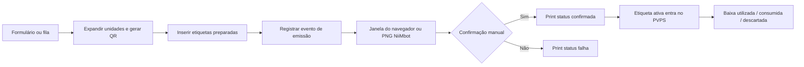

# Funcionalidades e regras de negócio

## 1. Perfis e acesso oferecido

Matriz da navegação atual em `ROLE_TABS` de `src/routes/index.tsx`. Ela descreve a interface; as permissões efetivas do banco estão no documento de dados.

| Recurso | Master | Nutricionista | Admin cliente | Gerente | Operador |
| --- | --- | --- | --- | --- | --- |
| Dashboard | Sim | Sim | Sim | Sim | Não no menu |
| Clientes | Sim | Sim | Não no menu | Não no menu | Não no menu |
| Produtos | Sim | Sim | Sim | Sim | Não no menu |
| Colaboradores | Sim | Sim | Sim | Sim | Não no menu |
| Emissão | Sim | Sim | Sim | Sim | Sim |
| PVPS | Sim | Sim | Sim | Sim | Sim |
| Histórico/reimpressão/duplicação | Sim | Sim | Sim | Sim | Sim |
| Área master | Sim | Não | Não | Não | Não |
| Escopo esperado | Todos | Carteira | Empresa própria | Empresa própria | Empresa própria |

O papel legado `admin` é interpretado como master. O banco aceita mais de um papel por usuário; a aplicação costuma usar `maybeSingle()` e pressupõe um papel único. Nutricionista vê a aba Clientes com controles de edição, mas o banco reserva a gestão da tabela a master.

Cards do dashboard mudam a aba diretamente e não reaplicam `ROLE_TABS`. Por exemplo, admin cliente pode abrir a aba Clientes pelo card apesar de ela estar ausente do menu. Isso não concede permissão SQL, mas evidencia inconsistência de navegação.

## 2. Acesso e ciclo de usuário

- E-mail/senha, Google, saída e recuperação por e-mail.
- Conta sem papel vê “Configuração inicial” e tenta reivindicar o primeiro master. Servidor aceita apenas se a tabela inteira `user_roles` estiver vazia.
- Master cria usuário com senha inicial opcional ou convite por e-mail. Admin cliente, gerente e operador exigem empresa.
- Operador criado pela área master também recebe entrada em `collaborators`; um colaborador cadastrado pela tela Equipe não ganha automaticamente uma conta Auth.
- Não há tela identificada para editar papel/vínculo de usuário existente, remover conta, suspender usuário individual ou gerenciar MFA.
- Reset master gera link, porém não há envio implementado naquele handler; ver diagnóstico.

## 3. Empresas

Cadastro: nome fantasia, razão social, CNPJ, cidade/UF, responsável, e-mail, telefone, endereço, plano e atividade/status. Busca da tela principal por nome, razão social, CNPJ, cidade e estado.

Existem dois fluxos: tela Clientes com chamadas diretas ao Supabase e área master com funções de servidor. Master permite suspender/reativar. A tela principal oferece inativação, embora o botão use ícone/descrição de excluir.

`status` aceita ativa, inativa e suspensa; `active` é booleano separado. O fluxo master sincroniza ambos, mas a inativação rápida da tela Clientes atualiza somente `active`.

Empresa suspensa vinculada ao perfil bloqueia a tela principal com aviso. O banco exige empresa operacional para **inserir etiquetas**; não bloqueia todas as demais operações sobre empresas suspensas/inativas.

Cada empresa tem `public_code` aleatório para QR Code de acesso. Pode-se visualizar, baixar PNG e imprimir o QR Code. Ele não substitui login ou permissão de vínculo.

## 4. Produtos

Campos da interface: empresa, nome, categoria, validade padrão de 0 a 3.650 dias, exigência de lote, exigência de inspeção, tipo SIF/SISP/SIM, número e observações. Busca por produto/categoria; edição e inativação.

Nome é único por empresa. Produtos inativos saem da consulta principal e não há fluxo identificado de listagem/reativação de inativos. `label_kind` e `storage_condition` existem no banco de produtos, mas não são editados nem aplicados automaticamente pelo formulário atual.

A tela deixa observações até 500 caracteres, enquanto o banco admite 1.000. Falhas de insert/update não são tratadas no formulário de produtos: ele pode resetar mesmo quando a gravação falha.

## 5. Colaboradores

Cadastro por empresa com nome, função e atividade. Busca por nome/função; edição e inativação. Colaborador pode existir sem `user_id` e representa o responsável impresso, que não necessariamente é a pessoa autenticada que emitiu a etiqueta.

A seleção do responsável é livre entre os colaboradores disponíveis da empresa. O emissor autenticado é registrado separadamente em `issued_by`.

## 6. Emissão

Sequência atual:

1. Selecionar empresa, produto e responsável.
2. Escolher tipo: manipulado, aberto, fracionado ou recebido.
3. Informar data e hora de manipulação/abertura.
4. Aplicar validade padrão ou editar prazo; escolher conservação e setor/local opcional.
5. Informar lote se o produto exigir; inspeção é preenchida pelo cadastro.
6. Definir de 1 a 200 cópias por item.
7. Opcionalmente editar diretamente nome, responsável, datas e lote da etiqueta.
8. Imprimir agora ou adicionar à fila temporária.

Conservação tem cinco presets: refrigerado ≤ 5 °C, congelado ≤ -18 °C, resfriado 6 °C a 10 °C, temperatura ambiente e quente ≥ 60 °C. São opções textuais do código, não regras de validade individual por conservação.

Prazo é calculado com `addDays`; a validade usa a mesma hora da abertura. Datas e exibição dependem do fuso do navegador. Prazo digitado zero usa o prazo do produto se ele for maior que zero, devido à condição `Number(shelfDays) > 0`.

O operador também consegue editar prazo e os textos/datas do rascunho. Essa possibilidade é mais ampla do que o briefing original de “operador apenas emite”. A regra de lote é verificada na interface; a RLS não recalcula validade nem garante lote obrigatório.

Fila fica em memória React. Cada cópia vira uma linha de banco com `quantity = 1`, token e QR Code próprios. O limite 200 é por item; não há limite global de itens/cópias do lote.

## 7. Impressão e confirmação

Tamanhos atuais: 60 × 40 mm ou 50 × 30 mm, com escala tipográfica 0,78 no menor formato. Preview e impressão HTML usam a mesma marcação de `src/lib/label.ts`.

Na impressão comum, iframe invisível recebe documento completo e chama `window.print()`. A seleção de impressora, driver, papel, margens e escala ocorre no sistema/navegador. O retorno positivo indica preparação do iframe, não confirmação de impressão física.

Tipos oferecidos: NiiMbot, Elgin, Bematech, Zebra, Tomate, Argox e outra térmica. Modos browser, Wi-Fi/IP, Bluetooth e USB são salvos, mas não há transporte direto por IP, Web Bluetooth ou USB implementado. Todos os tipos exceto NiiMbot usam impressão do navegador.

NiiMbot gera PNG por canvas em aproximadamente 203 DPI, para download e envio pelo aplicativo externo. No lote atual somente a última unidade é disponibilizada como PNG; não existe exportação de todas as unidades. Seu desenho canvas é separado do layout HTML, podendo divergir do preview.

Há teste de impressão sem registro no banco e instruções de driver para Elgin L42. O QR Code do teste não aponta para uma etiqueta persistida. Não foi homologada impressão física nesta etapa.

Confirmação usa `print_status = preparada` como condição de atualização; rejeição marca falha. As referências à confirmação pendente ficam apenas em memória e não são restauradas após reload.

## 8. PVPS

Mostra etiquetas com impressão confirmada e ciclo ativo, ordenadas pela validade. Filtros por empresa, produto e lote. Blocos: vencidos, vencem hoje, próximos do vencimento e dentro do prazo.

Antecedência configurável entre 1 e 90 dias, padrão 3, salva no navegador. A coluna `label_settings.expiry_alert_days` não é lida nem atualizada.

A classificação “vencido” compara o **dia**, portanto uma etiqueta que venceu às 08h permanece em “Vencem hoje” às 15h. Já a consulta QR considera horário exato e proximidade de 12 horas; os dois critérios divergem.

Baixas oferecidas: utilizada, consumida e descartada. Atualizam `label_status` e gravam evento. Não preenchem `closed_at`, `closed_by` ou `closed_reason`. Não há atualização por temporizador/realtime: a tela pode permanecer desatualizada quando o relógio muda ou outra pessoa opera.

O painel deriva dos últimos **500 registros por emissão**, consultados para o histórico; não consulta todas as etiquetas ativas diretamente. Etiquetas antigas ainda ativas podem ficar fora do controle.

## 9. Histórico e rastreabilidade

Busca por produto, responsável, empresa e data; reimpressão e duplicação. Texto anuncia últimas 100 emissões, mas consulta carrega 500. Filtro de data usa trecho UTC de `issued_at`, enquanto o horário é exibido no fuso local.

Reimprimir mantém token e não cria outra linha. Incrementa contador e registra evento, sem confirmação física desse novo papel. Duplicar preenche um novo rascunho, conserva datas antigas e terá outro token na emissão; não restaura todos os metadados/hora/tipo/conservação do registro original.

Consulta pública `/label/:token` apresenta produto, empresa, setor, localização, lote, inspeção, responsável, abertura, validade, emissão e situação. Qualquer pessoa com o token pode consultar esses dados. Não apresenta status de impressão e pode mostrar como ativa uma etiqueta preparada ou com falha.

`label_events` recebe eventos, mas não há interface de linha do tempo nem consulta dessa tabela no histórico atual. A área Atividades lê `activity_logs`, uma tabela diferente; `logActivity` não tem chamadas nos fluxos de negócio identificados.

## 10. Diferenças para a intenção original

| Briefing/plano | Estado encontrado |
| --- | --- |
| Dois perfis: admin e operador | Cinco atuais mais `admin` legado |
| Operador apenas emissão | Também PVPS, baixas, histórico e edição de rascunho |
| QR/rastreio como futuro | Já implementados |
| Evitar dashboards no primeiro escopo | Dashboard simples e estatísticas master presentes |
| Layout configurável por cliente | Tabela existe; UI usa constantes e preferências locais |
| Antecedência por empresa | Implementação salva por navegador |
| Linha do tempo visível | Eventos gravados; visualização ausente |
| Data/hora da emissão na etiqueta | Guardadas no banco, mas `labelMarkup` não imprime `issued` |
| Mensalidade R$ 59,90 | Informação de briefing; cobrança/assinatura não implementada |
| Bluetooth futuro | Opção visual presente, transporte ainda ausente |

Leitura de código de barras, voz, IA, FoodChecker, controle financeiro e integrações diretas de impressora não foram encontrados.
