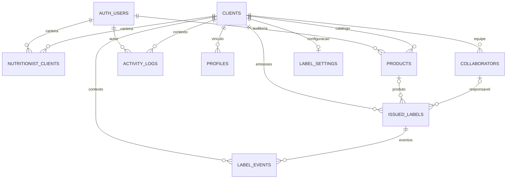

# Banco de dados

## 1. Fonte e alcance

Modelo reconstruído das dez migrações em `supabase/migrations`, da migração `drizzle/migrations/0000_pvps_print_confirmation.sql` e dos tipos em `src/integrations/supabase/types.ts`. São **dez tabelas de aplicação** no schema `public`, além da infraestrutura Auth do Supabase. Não houve consulta ao catálogo ou exportação do banco remoto; volume de registros e aplicação efetiva dos scripts não foram confirmados.

## 2. Relacionamentos

O diagrama representa FKs declaradas, usando `AUTH_USERS` como nome ilustrativo de `auth.users`. `profiles.user_id`, `user_roles.user_id`, `collaborators.user_id` e `issued_labels.issued_by` são UUIDs de usuário usados logicamente, mas **não têm FK Auth nas migrações analisadas**. `confirmed_by`, `source_label_id` e `label_events.user_id` também não têm FK declarada. Nomes copiados nas etiquetas preservam parte do contexto histórico, mesmo após alteração de cadastros.

## 3. Enums

| Tipo | Valores |
| --- | --- |
| `app_role` | `admin`, `operator`, `admin_master`, `nutricionista`, `admin_cliente`, `gerente` |
| `inspection_type` | `SIF`, `SISP`, `SIM` |
| `client_status` | `ativa`, `inativa`, `suspensa` |
| `label_kind` | `manipulado`, `aberto`, `fracionado`, `recebido` |
| `label_lifecycle` | `ativa`, `utilizada`, `consumida`, `descartada`, `cancelada` |
| `print_status` | `preparada`, `confirmada`, `falha`, `cancelada` |

`no_prazo`, `proximo` e `vencido` são estados calculados no frontend, não valores persistidos em `label_lifecycle`.

## 4. Dicionário das tabelas

### `clients` — estabelecimentos

| Campos | Tipo / regra |
| --- | --- |
| `id` | UUID PK, gerado |
| `name` | Texto obrigatório, trim 2–120 caracteres |
| `active` | Boolean obrigatório, default true |
| `status` | Enum obrigatório, default ativa |
| `legal_name` | Texto nullable, trim 2–200 quando presente |
| `cnpj` | Texto nullable, trim 14–20; não valida dígitos verificadores nem unicidade |
| `city`, `state` | Texto obrigatório, default vazio; limites 100 e 50 |
| `responsible_name`, `email`, `phone`, `address` | Texto nullable; sem checks adicionais no SQL que os introduz |
| `plan` | Texto obrigatório, default essencial; não é enum nem assinatura financeira |
| `public_code` | Texto obrigatório e único, aleatório de 12 bytes em hex |
| `created_at`, `updated_at` | TIMESTAMPTZ obrigatório, default now |

Não há constraint que sincronize `active` e `status`. `public_code` é o identificador do QR de entrada na empresa.

### `profiles` — perfil de aplicação

| Campos | Tipo / regra |
| --- | --- |
| `id` | UUID PK gerado |
| `user_id` | UUID obrigatório e único; vínculo lógico Auth |
| `client_id` | UUID nullable, FK clients, DELETE RESTRICT |
| `name` | Texto obrigatório, trim 2–120 |
| `email` | Texto obrigatório, trim 3–255; não valida formato de e-mail no SQL |
| `created_at`, `updated_at` | TIMESTAMPTZ obrigatório, default now |

Uma empresa principal por perfil. Os clientes adicionais de nutricionista são definidos em carteira.

### `user_roles` — papéis

`id` UUID PK; `user_id` UUID obrigatório; `role` enum obrigatório; `created_at` TIMESTAMPTZ default now. Unique composta `(user_id, role)` permite vários papéis diferentes para o mesmo usuário. Não há unicidade somente por `user_id`.

### `products` — catálogo por empresa

| Campos | Tipo / regra |
| --- | --- |
| `id` | UUID PK gerado |
| `client_id` | UUID obrigatório, FK clients, DELETE CASCADE |
| `name`, `category` | Texto obrigatório, trim 2–120 e 2–80 |
| `shelf_life_days` | Integer obrigatório, 0–3.650 |
| `requires_lot`, `requires_inspection` | Boolean obrigatório, default false |
| `inspection_type`, `inspection_number` | Enum/texto nullable; check condicional descrito abaixo |
| `notes` | Texto nullable, máximo 1.000 |
| `active` | Boolean obrigatório, default true |
| `storage_condition` | Texto nullable |
| `label_kind` | Enum obrigatório, default aberto |
| `created_by`, `updated_by` | UUID nullable, FK auth.users |
| `created_at`, `updated_at` | TIMESTAMPTZ obrigatório, default now |

Unique `(client_id, name)` e índice `client_id`. Inspeção desabilitada exige tipo e número nulos. Inspeção habilitada exige tipo e comprimento do número entre 1 e 40 no check; como CHECK aceita expressão nula no PostgreSQL, a ausência de `inspection_number` merece teste específico e reforço de NOT NULL condicional. Não há normalização de caixa para unicidade de nome.

### `collaborators` — responsáveis

`id` UUID PK; `client_id` obrigatório FK clients CASCADE; `user_id` UUID nullable e único; `name` obrigatório 2–120; `email` nullable 3–255; `role_title` texto nullable; `active` obrigatório default true; `created_at/updated_at` TIMESTAMPTZ default now. Unique `(client_id, name)` e índice por cliente.

Pode existir sem conta de login. A unicidade de `user_id` impede a mesma conta de ser vinculada diretamente como colaborador de várias empresas.

### `issued_labels` — cada etiqueta física

| Campos | Tipo / finalidade |
| --- | --- |
| `id` | UUID PK gerado |
| `client_id` | UUID obrigatório, FK clients RESTRICT |
| `product_id` | UUID nullable, FK products SET NULL |
| `responsible_id` | UUID nullable, FK collaborators SET NULL |
| `issued_by` | UUID obrigatório, autor original, sem FK declarada |
| `issued_by_user_id` | UUID nullable, FK Auth, preenchimento por trigger |
| `client_name`, `product_name`, `responsible_name` | Texto obrigatório, snapshots |
| `lot_number`, `inspection_label` | Texto nullable, snapshots |
| `opened_on`, `expires_on` | DATE obrigatório; check expires_on ≥ opened_on |
| `opened_at`, `expires_at` | TIMESTAMPTZ nullable; datas/horas atuais |
| `issued_at` | TIMESTAMPTZ obrigatório, default now |
| `quantity` | Integer obrigatório, default 1; sem check de positividade |
| `public_token` | Texto obrigatório e único, default aleatório 16 bytes hex |
| `label_kind`, `label_status` | Enums obrigatórios, defaults aberto e ativa |
| `storage_condition`, `sector`, `location` | Texto nullable |
| `closed_at`, `closed_by`, `closed_reason` | TIMESTAMPTZ/UUID/texto nullable; closed_by FK Auth |
| `print_status` | Enum obrigatório, default preparada |
| `confirmed_at`, `confirmed_by` | TIMESTAMPTZ/UUID nullable |
| `reprint_count` | Integer obrigatório, default 0; sem check de não negatividade |
| `source_label_id` | UUID nullable; sem FK declarada e sem preenchimento no fluxo de duplicação |

Índices: `(client_id, issued_at DESC)`, `public_token` único, `(label_status, expires_at)` e `(client_id, print_status, label_status, expires_at)`.

DATE e TIMESTAMPTZ convivem; não há constraint para garantir consistência entre os pares. O SQL verifica ordem das datas, mas não ordem dos timestamps. Também não recalcula prazo com base no produto nem valida o conteúdo dos snapshots.

Backfill de agosto preenche abertura antiga à meia-noite e validade às 23:59 em `America/Sao_Paulo`. Emissões atuais usam hora local de abertura e a mesma hora na validade. A RPC usa fallback de validade à meia-noite se o timestamp for nulo; o PVPS usa fallback 23:59. Isso merece harmonização futura.

### `label_settings` — configuração por empresa

`id` UUID PK; `client_id` obrigatório único FK clients CASCADE; `header_text` obrigatório default TiNutri Smart Label®, 1–80; `show_logo` obrigatório default true; `width_mm`, `height_mm` NUMERIC(5,2), defaults 60/40, ambos 20–120; `expiry_alert_days` integer obrigatório default 3; `created_at/updated_at` TIMESTAMPTZ default now.

Existe no modelo, mas o frontend não a consulta nem grava. Preferências de impressão/alerta usam `localStorage`.

### `nutritionist_clients` — carteira

`id` UUID PK; `nutritionist_user_id` obrigatório FK auth.users CASCADE; `client_id` obrigatório FK clients CASCADE; `created_at` TIMESTAMPTZ default now; unique composta `(nutritionist_user_id, client_id)`.

Nem a tabela nem `assignNutritionistClient` garantem que o usuário vinculado tenha papel nutricionista. A UI limita a seleção, mas não equivale a constraint.

### `activity_logs` — atividade geral

`id` UUID PK; `client_id` nullable FK clients SET NULL; `user_id` nullable FK Auth SET NULL; `user_name`, `entity_type` nullable; `action` texto obrigatório; `entity_id` UUID nullable sem FK; `metadata` JSONB obrigatório default `{}`; `created_at` TIMESTAMPTZ default now.

Índices por `(client_id, created_at DESC)` e `created_at DESC`. A UI master lê a tabela; não foram encontradas chamadas de gravação nos fluxos principais.

### `label_events` — eventos por etiqueta

`id` UUID PK; `label_id` obrigatório FK issued_labels CASCADE; `client_id` obrigatório FK clients CASCADE; `event_type` texto obrigatório; `user_id` UUID e `user_name` texto nullable; `quantity` integer obrigatório default 1; `metadata` JSONB obrigatório default `{}`; `created_at` TIMESTAMPTZ default now. Índice `(label_id, created_at DESC)`.

Tipos enviados pela UI: `emissao`, `impressao_confirmada`, `falha_impressao`, `reimpressao`, `baixa_utilizada`, `baixa_consumida`, `baixa_descartada`. O banco não restringe esses valores por enum/check. Não há constraint composta para garantir que `label_id` e `client_id` apontem para a mesma empresa.

## 5. Funções e triggers

| Função | Finalidade |
| --- | --- |
| `private.has_role` | Helper legado, compara usuário com auth.uid e papel |
| `private.current_client_id` | Empresa principal do perfil |
| `private.is_admin_master` | Aceita admin legado e admin_master |
| `private.is_nutricionista`, `is_admin_cliente`, `is_gerente` | Teste de papel |
| `private.nutritionist_has_client` | Testa presença de vínculo em carteira; não exige papel no próprio helper |
| `private.user_can_access_client` | Master, empresa do perfil ou vínculo em carteira |
| `private.client_is_operational` | Empresa com status ativa |
| `public.get_label_by_token` | RPC pública SECURITY DEFINER, retorno de uma etiqueta pelo token |
| `public.set_updated_at` | Timestamp de atualização de clients, profiles, products, collaborators e label_settings |
| `public.set_products_audit` | Auditoria de criação/edição de produto |
| `public.set_issued_label_user` | Preenche issued_by_user_id na inserção |

Funções de permissão têm SECURITY DEFINER e search_path explícito. Helpers novos merecem auditoria de privilégios padrão; a revogação explícita aplicada aos helpers antigos não aparece da mesma maneira em todos os novos scripts. RPC pública é deliberadamente concedida a `anon` e `authenticated`.

## 6. RLS e grants efetivos no histórico

Todas as dez tabelas habilitam RLS nos scripts. `service_role` recebe acesso total. Matriz resumida das políticas finais:

**Distinção necessária:** a tabela abaixo descreve as políticas RLS. O privilégio SQL também é obrigatório. `issued_labels` recebe explicitamente SELECT/INSERT na migração inicial; não foi localizado GRANT UPDATE nos scripts posteriores. Portanto, o uso de UPDATE pela UI depende de grants/default privileges externos ao histórico explícito, que precisam ser conferidos no ambiente e no destino.

| Tabela | Leitura autenticada | Escrita autenticada |
| --- | --- | --- |
| clients | Master ou empresa acessível | Master |
| profiles | Próprio ou perfil de empresa acessível; master geral | Master; usuário pode atualizar linha própria, sem restrição de coluna |
| user_roles | Próprio ou admin legado pela política antiga | Não há grant de escrita ao authenticated; gestão via service role |
| products | Qualquer produto de empresa acessível | Master; nutri/admin cliente/gerente em escopo para insert/update/delete |
| collaborators | Empresa acessível | Master; nutri/admin cliente/gerente para insert/update; sem delete para esses três |
| label_settings | Empresa acessível | Master |
| nutritionist_clients | Própria carteira ou master | Master |
| issued_labels | Empresa acessível/master | Insert exige autor atual, empresa acessível ativa, produto e responsável ativos do mesmo cliente; update por empresa acessível sem limitação de coluna |
| activity_logs | Empresa acessível/master | Insert exige usuário atual e empresa acessível ou nula |
| label_events | Empresa acessível | Insert em empresa acessível; user_id nulo ou usuário atual |

Leitura pública direta de tabelas não é concedida pelos scripts; a consulta anônima de etiqueta ocorre via RPC. Políticas são permissivas e seu conjunto precisa ser avaliado, não apenas uma regra isolada.

A política de `user_roles` não foi consolidada para `is_admin_master`: usuários master modernos leem o próprio papel, mas a função master `listAllUsers` usa service role para listar todos. Queries antigas que esperam master lendo todos os papéis diretamente podem divergir.

Riscos principais: alteração de `profiles.client_id` pelo próprio usuário; alteração ampla de etiquetas; inserção de eventos com empresa dissociada da etiqueta; leitura de perfis de todos os usuários da empresa por qualquer conta com acesso ao cliente. Detalhes em [diagnóstico](05-diagnostico.md).

## 7. Histórico de migrações

| Prefixo | Conteúdo |
| --- | --- |
| `20260613141951` | Enums originais, sete tabelas iniciais, funções, RLS, índices e triggers |
| `20260613142016` | Restringe helpers públicos e comparação de usuário |
| `20260613142053` | Move helpers ao schema private e ajusta políticas |
| `20260613145250` | Razão social, CNPJ, cidade e estado |
| `20260623154042` | Função do colaborador e quantidade |
| `20260623164000` | Corrige referências correlacionadas na política de emissão |
| `20260623190532` | Perfis ampliados, status de empresa, carteira, atividade e auditoria |
| `20260623190550` | Papel gerente |
| `20260827232942` | Contatos/plano/QR da empresa e permissões gerente |
| `20260827235744` | Ciclo da etiqueta, tipo, timestamps, conservação, RPC pública |
| `drizzle/0000_pvps_print_confirmation` | Print status, confirmação, contador, origem, alerta e eventos |

O schema Drizzle está vazio. Ele não é uma representação declarativa das dez tabelas. Um `drizzle generate` futuro não deve ser considerado mecanismo seguro de reconstrução sem revisar esse estado.

Os scripts chamam `gen_random_bytes` sem schema em uma migração e `extensions.gen_random_bytes` em outra. Disponibilidade da extensão e search_path precisam ser conferidos no destino. Enums, schema private, grants, Auth e transações de migração também exigem ensaio em ambiente vazio.

Não existe dump de dados, seed, contagem de tabelas ou prova de restauração no repositório. Tipos gerados refletem recursos de PVPS, mas não provam sozinhos que a produção aplica todas as migrações.
